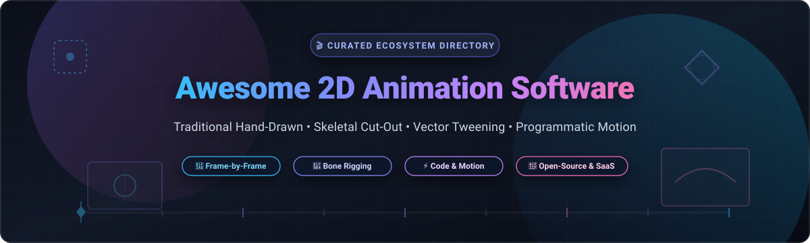

# 🎬 Awesome 2D Animation Software 🚀

### ✨ A Curated Directory of Industry-Standard Commercial Platforms & Open-Source 2D Animation Software ✨

  <b>A comprehensive guide to traditional frame-by-frame, cut-out skeletal rigging, vector tweening, pixel art sprite engines, and programmatic code-driven animation tools.</b>
   
  <i>Comparing SaaS pricing models, free trial restrictions, studio market dynamics, and star-ranked open-source alternatives.</i>

---

## 📑 Table of Contents

- [📊 Sector Overview & Market Dynamics](#-sector-overview--market-dynamics)
- [🏢 SaaS & Commercial Platforms](#-saas--commercial-platforms)
- [💻 Open-Source GitHub Projects](#-open-source-github-projects)
- [🤝 Support](#-support)
- [📈 Star History](#-star-history)
- [🛠️ How to Contribute](#️-how-to-contribute)
- [⚖️ Disclaimer](#️-disclaimer)

---

## 📊 Sector Overview & Market Dynamics

The global **2D animation software market** is estimated at **$2.7B to $4.8B** (projected to expand past **$7.5B** at a 5–8% CAGR), propelled by rising demand across OTT streaming networks, indie game development, social media video pipelines, and interactive digital advertising. 

The industry demonstrates **high market fragmentation** rather than a winner-take-all monopoly:
- **Enterprise Broadcast & Feature Studios:** Highly customized vector and bitmap suites ([Toon Boom Harmony](https://www.toonboom.com/products/harmony), [CelAction2D](https://www.celaction.com/), [TVPaint](https://www.tvpaint.com/)) dominate established film and television pipelines.
- **Web, Marketing & Rapid Content:** Cloud-based template engines ([Vyond](https://www.vyond.com/), [Animaker](https://www.animaker.com/)) dominate corporate L&D, explainer videos, and social media production.
- **Indie Animators & Game Artists:** Versatile desktop tools ([Moho Pro](https://moho.lostmarble.com/), [Clip Studio Paint](https://www.clipstudio.net/en/), [Cartoon Animator](https://www.reallusion.com/cartoon-animator/)) serve digital comic artists and 2D game developers.
- **Open-Source Powerhouses:** Robust, studio-grade free ecosystems ([Blender Grease Pencil](https://github.com/blender/blender), [OpenToonz](https://github.com/opentoonz/opentoonz), [Krita](https://github.com/KDE/krita)) provide viable alternatives that lower barriers to entry worldwide.

---

## 🏢 SaaS & Commercial Platforms

| Product 🎨 | Description 📝 | Valuation / Revenue (Company Size) 🏢 | Pricing 💳 | Free Tier / Free Trial Limits ⏱️ |
| :--- | :--- | :--- | :--- | :--- |
| **[Adobe Animate](https://www.adobe.com/products/animate.html)** | Versatile vector animation, frame-by-frame drawing, and interactive web/HTML5 export platform integrated with Adobe Creative Cloud. | **~$94B Market Cap** (Adobe Inc., NASDAQ: ADBE; ~$21B+ annual revenue) | From **$22.99/mo** (Annual plan, paid monthly) or **$34.49/mo** (Monthly plan) | **7-day free trial** (Full unrestricted access to all features; payment details required, auto-renews unless canceled). |
| **[Toon Boom Harmony](https://www.toonboom.com/products/harmony)** | Premium studio-standard 2D animation suite with advanced rigging, node compositing, and hybrid paperless workflows. | **$111.4M ($147.5M CAD) Acquisition Valuation** (Acquired by IMC/TPG from Corus Entertainment in 2023) | **Essentials:** From **$22/mo** billed annually ($259/yr) or **$31/mo**; **Advanced:** $51/mo; **Premium:** $97/mo | **14-day free trial** (Full feature access to downloaded tier; single-use per version/machine). |
| **[Clip Studio Paint](https://www.clipstudio.net/en/)** | Leading illustration and animation package supporting raster/vector drawing, onion skinning, and multi-track animation. | **~$45M Annual Recurring Revenue** (Celsys, Inc., TYO: 3663; ~6.6B JPY ARR) | **PRO:** From **$2.25/mo** ($26.99/yr) or **$4.49/mo** (or $63 one-time perpetual); **EX:** From $76.99/yr | **30-day free trial** (or up to 3 months with recurring plans; unrestricted trial, reverts to non-saving/non-exporting mode thereafter). Smartphone plans offer 30 hrs/month free. |
| **[Vyond](https://www.vyond.com/)** | Cloud-based enterprise 2D animated video creation suite featuring AI lip-sync, customizable characters, and template workflows. | **~$35M ARR** (GoAnimate, Inc.; privately held, enterprise market leader) | **Essential/Starter:** From **$49/mo** ($588/yr) or **$89/mo**; **Professional:** From $100/mo ($1,199/yr) | **14-day free trial** (Includes trial credit allocation and full studio tools; all video exports include a watermark). |
| **[Moho Pro](https://moho.lostmarble.com/)** | Cut-out and puppet animation workstation renowned for bone rigging, smart warp, physics engine, and bitmap/vector blending. | **~$15M - $20M Valuation** (Lost Marble LLC; established independent studio software vendor) | **Moho Debut:** **$59.99** one-time perpetual; **Moho Pro:** **$399.99** one-time perpetual | **30-day free trial** (Full tool access, but file export is disabled, imports restricted, and renders watermarked). |
| **[Animaker](https://www.animaker.com/)** | Web-hosted DIY 2D animation and explainer video platform featuring drag-and-drop character animation and extensive asset libraries. | **~$10M - $15M ARR** (Animaker Inc.; bootstrapped private SaaS serving 18M+ users) | **Basic:** From **$12.50/mo** ($150/yr) or **$24/mo**; **Starter:** From $25/mo; **Pro:** From $49/mo | **Free-for-ever plan** (Limited to 5 watermarked downloads/mo, 720p quality, 5-minute video length, standard assets). Also offers 7-day Pro trials. |
| **[Cartoon Animator](https://www.reallusion.com/cartoon-animator/)** | 2D character animation workstation specializing in rapid puppet animation, 360-degree head creation, motion capture, and audio lip-sync. | **~$8M Revenue** (Reallusion Inc., TPEX: 6882; ~252M TWD annual revenue) | **Cartoon Animator 5:** **$149.00** one-time perpetual (or **$99/yr** subscription for CA 365 Pro) | **30-day free trial** (Full functional access to rigging, animation tools, and mocap trial plugins for 30 days). |
| **[TVPaint Animation](https://www.tvpaint.com/)** | Bitmap-based traditional frame-by-frame 2D animation package favored by European and Japanese animation studios for hand-drawn aesthetics. | **~$5M - $10M Revenue** (TVPaint Developpement; privately held French specialist) | **Standard:** **€650 (~$700 USD)** one-time perpetual; **Professional:** **€1,600 (~$1,740 USD)** one-time perpetual | **Unlimited-time free trial** (Trial has no expiration date, but project saving and file exporting are completely disabled). |
| **[CelAction2D](https://www.celaction.com/)** | Specialized production-scale 2D puppet animation tool powering broadcast series (e.g., Peppa Pig, Mr Bean). | **~$2M - $5M Revenue** (CelAction Ltd; boutique UK animation production software company) | **Studio Rental:** From **$100/mo** (£80/mo) or **$825/yr** (£660/yr) | **No public free trial** (Studio demonstration kits provided on request upon contacting sales for qualified production houses/pros). |

---

## 💻 Open-Source GitHub Projects

*Curated open-source animation engines, standalone suites, programmatic frameworks, and pixel-art tools sorted by GitHub star counts.*

| Project 🌟 | Stars ⭐ | Description 📖 |
| :--- | :--- | :--- |
| **[Remotion](https://github.com/remotion-dev/remotion)** |  | Programmatic video and 2D animation framework allowing developers to build frame-accurate animated graphics and videos using React, HTML, CSS, and Canvas. |
| **[Aseprite](https://github.com/aseprite/aseprite)** |  | Industry-standard animated sprite editor and pixel art tool featuring onion skinning, timeline layers, tilesets, and frame-by-frame game animation. |
| **[Lottie Web](https://github.com/airbnb/lottie-web)** |  | Cross-platform runtime and web player that renders vector 2D animations exported from animation tools natively across Web, iOS, and Android. |
| **[Blender (Grease Pencil)](https://github.com/blender/blender)** |  | Comprehensive open-source 3D suite featuring the powerful Grease Pencil system for full 2D hand-drawn animation, vector sculpting, and hybrid 2D/3D studio pipelines. |
| **[Motion Canvas](https://github.com/motion-canvas/motion-canvas)** |  | Code-driven 2D animation toolkit and visual editor for creating programmatic motion graphics, interactive diagrams, and technical animations via TypeScript. |
| **[Krita](https://github.com/KDE/krita)** |  | Full-featured digital sketching and painting workstation with built-in frame-by-frame raster animation timeline, audio playback, onion skinning, and export tools. |
| **[OpenToonz](https://github.com/opentoonz/opentoonz)** |  | Production-grade 2D animation suite based on the software customized by Studio Ghibli, featuring x-sheets, scanning, vector/bitmap drawing, effects, and camera work. |
| **[Synfig Studio](https://github.com/synfig/synfig)** |  | Film-quality 2D vector animation software designed to eliminate manual in-betweening via automatic morphing tweening, cutout bone rigging, and parametric layers. |
| **[Pencil2D](https://github.com/pencil2d/pencil)** |  | Lightweight, accessible application for traditional hand-drawn 2D animation, featuring seamless switching between raster and vector workflows. |
| **[Enve](https://github.com/MaurycyLiebner/enve)** |  | Flexible, extensible 2D vector and raster animation workstation for Linux and Windows with audio integration, path morphing, shaders, and hardware acceleration. |
| **[Wick Editor](https://github.com/Wicklets/wick-editor)** |  | Beginner-friendly browser-based and desktop 2D animation and game creation platform inspired by Adobe Flash and HyperCard, designed for schools and indie creators. |
| **[AnimeEffects](https://github.com/hidefuku/AnimeEffects)** |  | Keyframe-driven 2D sprite and character animation tool that animates polygon meshes, free-form deformation, bone deformation, and image filters for 2D game assets. |
| **[VPaint](https://github.com/dalboris/vpaint)** |  | Vector graphics and 2D animation editor based on the Vector Animation Complex (VAC) topology, supporting free-form vector painting, sculpt deformation, and morphing. |
| **[Tahoma2D](https://github.com/tahoma2d/tahoma2d)** |  | User-streamlined fork of OpenToonz focused on traditional 2D and stop-motion animation with enhanced interface customization, audio scrub, and simplified setup. |
| **[StretchyStudio](https://github.com/MangoLion/stretchystudio)** |  | Open-source 2D animation tool designed for turning static digital illustrations into mesh-deformable cut-out character puppets with interactive inverse kinematics. |
| **[Glaxnimate](https://github.com/mbasaglia/glaxnimate)** |  | Fast vector graphics and 2D animation editor with native support for Lottie, animated SVG, Rive, and direct integration into video editors like Kdenlive and Shotcut. |

---

## 🤝 Support

Thank you for visiting and supporting **Awesome-2D-Animation-Software**! 💖

If you found this curated list helpful for your animation projects, pipelines, or research, please consider:
- 🌟 **Starring** this repository to help others discover it
- 🍴 **Forking** and contributing new animation software or updates
- 📢 **Sharing** with fellow animators, digital artists, developers, and educators
- ☕ **Buying a coffee / Sponsoring** the maintainer via the [GitHub Sponsor Dashboard](https://github.com/sponsors/ishandutta2007)

Your support fuels continued maintenance, updates, and open-source creative resources!

---

## 📈 Star History

---

## 🛠️ How to Contribute

1. 🍴 Fork the repository.
2. 📝 Add or edit entries in `README.md` (keep tables neatly organized and sorted).
3. 🔍 Ensure accurate pricing, trial limits, repository star badges, and links.
4. 🚀 Submit a pull request with a concise description of changes.

---

## ⚖️ Disclaimer

- This is a **community-curated** list — not exhaustive and not an endorsement.
- Animation software choices depend on production requirements, team skills, budget, and output format. Open-source tools are powerful but may require technical setup and lack certain commercial enterprise guarantees.

---

  <b>Made with ❤️ for animators, studios, educators, and open-creative-tool advocates.</b>

